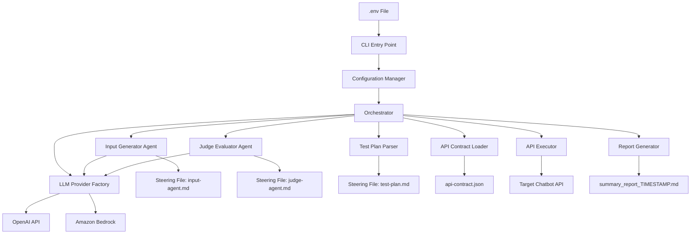
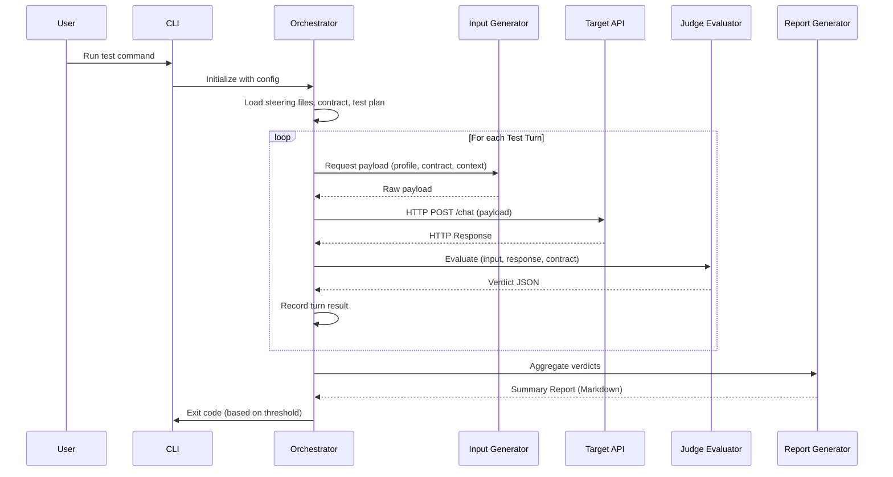

# Design Document: Dynamic Multi-Agent Chatbot REST API Tester

## Overview

This system implements an automated multi-agent framework that stress-tests, evaluates, and audits a Chatbot REST API. It uses an Orchestrator pattern where a central engine coordinates specialized sub-agents — an Input_Generator that produces diverse adversarial test payloads and a Judge_Evaluator that critically assesses API responses.

The system is designed as a CLI tool (Node.js/TypeScript) that executes a configurable number of test turns against a target chatbot API endpoint. Each turn follows a pipeline: generate input → call API → evaluate response → record verdict. Results are aggregated into a Markdown summary report.

### Key Design Decisions

1. **TypeScript with Node.js** — Chosen for strong typing, async/await support for concurrent HTTP requests, and rich ecosystem for CLI tooling and JSON schema validation.
2. **Orchestrator Pattern** — A central coordinator manages the lifecycle rather than peer-to-peer agent communication, simplifying error isolation and state management.
3. **LLM-backed Sub-Agents** — The Input_Generator and Judge_Evaluator are LLM-powered agents whose behavior is steered by markdown persona files, enabling customization without code changes. Falls back to deterministic template/rule-based behavior when no LLM is configured.
4. **Fail-forward Resilience** — Individual turn failures are isolated and logged; the suite always runs to completion to maximize coverage.
5. **Multi-Provider LLM Support** — Supports OpenAI and Amazon Bedrock as interchangeable LLM backends via a common `LLMProvider` interface.
6. **Environment-First Configuration** — All sensitive credentials (API keys, tokens) are loaded from a `.env` file via dotenv, keeping secrets out of version control.

## Architecture

The system follows a layered architecture with clear separation between orchestration, agent management, API communication, and reporting.



### Execution Flow



## Components and Interfaces

### 1. CLI Entry Point (`src/cli.ts`)

Loads `.env` via dotenv, parses command-line arguments, resolves configuration (CLI args override env vars override defaults), and invokes the Orchestrator.

```typescript
interface CLIOptions {
  endpoint?: string;         // Target API URL (or API_TEST_ENDPOINT env var)
  turns?: number;            // Number of test turns (1-1000, default 5)
  timeout?: number;          // Request timeout in seconds (1-300, default 30)
  mode?: string;             // Execution mode: sequential or concurrent (default: sequential)
  concurrency?: number;      // Concurrency limit (1-100, default 5)
  contractPath?: string;     // Path to API contract file (default: ./api-contract.json)
  authToken?: string;        // Bearer token (or API_TEST_AUTH_TOKEN env var)
  testPlan?: string;         // Path to test plan file (or API_TEST_PLAN env var)
  verbose?: boolean;         // Include all turn details in report (or API_TEST_VERBOSE env var)
}
```

### 2. Configuration Manager (`src/config.ts`)

Resolves configuration from CLI args, environment variables, and `.env` file (CLI takes precedence over env vars over defaults). Validates all values against defined ranges.

```typescript
interface ResolvedConfig {
  endpoint: string;
  turnCount: number;
  timeoutMs: number;
  executionMode: 'sequential' | 'concurrent';
  concurrencyLimit: number;
  contractPath: string;
  authToken?: string;
  verbose: boolean;
  steeringPaths: {
    inputAgent: string;
    judgeAgent: string;
    testPlan: string;
  };
  outputDir: string;
}
```

### 3. Orchestrator (`src/orchestrator.ts`)

The central coordination engine. Manages the test lifecycle, spawns agents, handles error isolation, and drives execution.

```typescript
interface Orchestrator {
  initialize(config: ResolvedConfig): Promise<void>;
  runSuite(): Promise<TestSuiteResult>;
}

interface TestSuiteResult {
  turns: TestTurnResult[];
  startTime: Date;
  endTime: Date;
  config: ResolvedConfig;
}
```

### 4. Input Generator Agent (`src/agents/input-generator.ts`)

LLM-backed agent that produces test payloads. Receives steering directives, API contract context, and test plan focus areas. When an LLM provider is configured, generates contextually relevant payloads based on scenario descriptions. Falls back to a deterministic template-based generator when no LLM is available.

```typescript
interface LLMProvider {
  generate(systemPrompt: string, userPrompt: string): Promise<string>;
}

class InputGeneratorAgent {
  constructor(steering: string, contract: APIContract, testPlanContext?: string);
  setLLMProvider(provider: LLMProvider): void;
  generatePayload(profile: InputProfile, turnIndex: number, scenarioContext?: string): Promise<GeneratedInput>;
}

interface GeneratedInput {
  payload: unknown;        // The raw payload (JSON object, string, or malformed data)
  profile: InputProfile;
  contentType: string;     // Content-Type header to use
  metadata: {
    description: string;   // Brief description of what this input tests
  };
}

type InputProfile = 'happy_path' | 'boundary_values' | 'malicious_content' | 'structural_anomalies';
```

**LLM Integration:** When an LLM provider is set, the agent builds a system prompt from the steering file + API contract context + test plan context, and a user prompt with the profile type, turn index, and scenario description. The LLM output is parsed as JSON (handling markdown fences and double-encoding). If parsing fails, the raw output is used as a text/plain payload. If the LLM call itself fails, a null payload with an `[ERROR]` description is returned.

### 5. API Executor (`src/api-executor.ts`)

Handles HTTP communication with the target API. Supports both sequential and concurrent execution modes. The endpoint path is derived from the API contract (not hardcoded). Sends an Authorization header when an auth token is configured.

```typescript
function executeRequest(
  input: GeneratedInput,
  endpoint: string,
  timeoutMs: number,
  authToken?: string,
  path?: string            // From contract.endpointPath, default: '/chat'
): Promise<APIResponse>;

function executeSequential(inputs: GeneratedInput[], endpoint: string, timeoutMs: number): Promise<APIResponse[]>;
function executeConcurrent(inputs: GeneratedInput[], endpoint: string, timeoutMs: number, concurrencyLimit: number): Promise<APIResponse[]>;

interface APIResponse {
  statusCode: number;
  headers: Record<string, string>;
  body: unknown;
  latencyMs: number;
  error?: {
    type: 'timeout' | 'connection_refused' | 'dns_failure' | 'tls_failure' | 'unknown';
    message: string;
  };
}
```

### 6. Judge Evaluator Agent (`src/agents/judge-evaluator.ts`)

Evaluates API responses using a dual approach: deterministic rule-based checks (schema, status codes, field types, latency) followed by optional LLM-based semantic evaluation (coherence, security, logic). Produces structured Verdict JSON.

```typescript
class JudgeEvaluatorAgent {
  constructor(steering: string, contract: APIContract);
  setLLMProvider(provider: LLMProvider): void;
  evaluate(input: GeneratedInput, response: APIResponse, turnId: string): Promise<Verdict>;
}

interface Verdict {
  testId: string;
  verdict: 'PASSED' | 'FAILED';
  confidenceScore: number;  // 0.0 to 1.0
  failureCategory: FailureCategory;
  summary: string;          // 1-200 characters
  assertions: Assertion[];  // 1-50 entries
}

interface Assertion {
  check: string;
  status: 'PASS' | 'FAIL';
  details: string;
}

type FailureCategory = 'NONE' | 'SCHEMA_VIOLATION' | 'UNHANDLED_EXCEPTION' | 'LOGIC_ERROR' | 'SECURITY_RISK' | 'PERFORMANCE_ISSUE';
```

**Evaluation Pipeline:**
1. **Deterministic checks** (always run): connection errors, body parseability, status code validation, required field presence/types, error format validation, latency threshold
2. **LLM semantic checks** (when provider configured): coherence, relevance, error leakage, adversarial handling, logical consistency. LLM assertions are prefixed with `[LLM]`. If the LLM call fails, a PASS assertion is added noting the error — deterministic checks still produce a valid verdict.

### 7. Test Plan Parser (`src/test-plan-parser.ts`)

Parses the test-plan.md steering file to extract profile distribution, scenario sequences, priority areas, and thresholds.

```typescript
interface TestPlan {
  profileDistribution: ProfileDistribution;
  scenarioSequences: ScenarioStep[];
  priorityAreas: string[];
  passThreshold: number;       // 0-100, default 100
  specialInstructions: string; // Additional context for agents
}

interface ProfileDistribution {
  happy_path: number;          // Percentage (0-100)
  boundary_values: number;
  malicious_content: number;
  structural_anomalies: number;
}

interface ScenarioStep {
  profile: InputProfile;
  description: string;
  context?: string;
}
```

### 8. API Contract Loader (`src/contract-loader.ts`)

Loads and validates the API contract file. Supports OpenAPI 3.x and JSON Schema Draft 7+ formats. Extracts the endpoint path from the contract.

```typescript
interface APIContract {
  format: 'openapi' | 'jsonschema';
  raw: object;                          // The full parsed contract
  endpointPath: string;                 // Extracted from contract paths (default: '/chat')
  requestSchema: RequestSchema;
  responseSchema: ResponseSchema;
}

interface RequestSchema {
  requiredFields: FieldDefinition[];
  requiredHeaders: Record<string, string>;
  contentType: string;
}

interface ResponseSchema {
  successStatusCodes: number[];
  errorStatusCodes: number[];
  bodyStructure: FieldDefinition[];
  errorFormat: FieldDefinition[];
}

interface FieldDefinition {
  name: string;
  type: string;
  required: boolean;
  constraints?: Record<string, unknown>;
}
```

**Endpoint Path Extraction:** For OpenAPI format, the path is taken from the first key in the `paths` object. For JSON Schema format, an optional `endpointPath` top-level field is read. Defaults to `/chat` if not determinable.

### 9. Report Generator (`src/report-generator.ts`)

Aggregates all test turn results into a structured Markdown summary report. Supports verbose mode which includes full details for all turns (not just failures).

```typescript
function generateReport(suiteResult: TestSuiteResult, testPlan: TestPlan, verbose?: boolean): string;
function writeReport(report: string, outputDir: string, startTime: Date): string; // Returns file path
function formatTimestamp(date: Date): string; // YYYYMMDDTHHMMSS UTC
```

**Verbose Mode:** When enabled, the details section includes every turn with status badges (✅ passed, ❌ failed, ⚠️ errored). When disabled (default), only failed turns are shown.

### 10. Steering File Loader (`src/steering-loader.ts`)

Utility for reading and validating steering file content.

```typescript
interface SteeringLoader {
  load(filePath: string): Promise<string>;  // Returns file content or throws
}
```

### 11. LLM Provider Factory (`src/llm-provider.ts`)

Creates the appropriate LLM provider based on available environment variables. Supports OpenAI and Amazon Bedrock as interchangeable backends.

```typescript
interface LLMProvider {
  generate(systemPrompt: string, userPrompt: string): Promise<string>;
}

function createOpenAIProvider(apiKey: string, orgId?: string, model?: string): LLMProvider;
function createBedrockProvider(accessKeyId: string, secretAccessKey: string, region: string, model?: string): LLMProvider;
function createLLMProvider(): LLMProvider | undefined;  // Factory: picks provider from env vars
```

**Provider Selection Priority:**
1. If `OPENAI_API_KEY` is set → OpenAI (model default: `gpt-4o-mini`)
2. If `BEDROCK_ACCESS_KEY_ID` + `BEDROCK_SECRET_ACCESS_KEY` + `BEDROCK_REGION` are set → Bedrock (model default: `us.anthropic.claude-sonnet-4-20250514-v1:0`)
3. If neither → returns `undefined` (agents fall back to deterministic behavior)

The same provider instance is shared between Input Generator and Judge Evaluator.

## Data Models

### Test Turn Result

```typescript
interface TestTurnResult {
  turnId: string;                    // Unique identifier (e.g., "turn-001")
  turnIndex: number;                 // 0-based index in the suite
  status: TurnStatus;
  profile: InputProfile;
  input?: GeneratedInput;            // Absent if input generation failed
  response?: APIResponse;            // Absent if API execution failed
  verdict?: Verdict;                 // Absent if evaluation failed
  error?: TurnError;                 // Present if any phase failed
  timestamps: {
    inputGenStart?: Date;
    inputGenEnd?: Date;
    apiCallStart?: Date;
    apiCallEnd?: Date;
    evaluationStart?: Date;
    evaluationEnd?: Date;
  };
}

type TurnStatus = 'passed' | 'failed' | 'skipped' | 'execution_error' | 'evaluation_error';

interface TurnError {
  phase: 'input_generation' | 'api_execution' | 'evaluation';
  type: string;
  message: string;
}
```

### Profile Allocation

The Orchestrator pre-computes which profile each turn should use based on the test plan distribution:

```typescript
interface ProfileAllocation {
  turnIndex: number;
  profile: InputProfile;
  isScenarioStep: boolean;
  scenarioContext?: string;
}
```

### Configuration Validation Rules

| Parameter | Type | Range | Default | Env Variable |
|-----------|------|-------|---------|--------------|
| endpoint | string (URL) | Valid HTTP(S) URL | (required) | `API_TEST_ENDPOINT` |
| authToken | string | Any non-empty string | (none) | `API_TEST_AUTH_TOKEN` |
| turns | integer | 1–1000 | 5 | `API_TEST_TURNS` |
| timeout | integer (seconds) | 1–300 | 30 | `API_TEST_TIMEOUT` |
| mode | enum | sequential, concurrent | sequential | `API_TEST_MODE` |
| concurrency | integer | 1–100 | 5 | `API_TEST_CONCURRENCY` |
| contractPath | string (file path) | Existing file ≤10MB | ./api-contract.json | `API_TEST_CONTRACT` |
| testPlanPath | string (file path) | Any file path | .kiro/steering/test-plan.md | `API_TEST_PLAN` |
| verbose | boolean | true/false | false | `API_TEST_VERBOSE` |

### LLM Provider Configuration

| Parameter | Env Variable | Required | Default |
|-----------|-------------|----------|---------|
| OpenAI API Key | `OPENAI_API_KEY` | For OpenAI | — |
| OpenAI Org ID | `OPENAI_ORG_ID` | No | — |
| OpenAI Model | `OPENAI_MODEL` | No | gpt-4o-mini |
| Bedrock Access Key | `BEDROCK_ACCESS_KEY_ID` | For Bedrock | — |
| Bedrock Secret Key | `BEDROCK_SECRET_ACCESS_KEY` | For Bedrock | — |
| Bedrock Region | `BEDROCK_REGION` | For Bedrock | — |
| Bedrock Model | `BEDROCK_MODEL` | No | us.anthropic.claude-sonnet-4-20250514-v1:0 |

## Correctness Properties

*A property is a characteristic or behavior that should hold true across all valid executions of a system — essentially, a formal statement about what the system should do. Properties serve as the bridge between human-readable specifications and machine-verifiable correctness guarantees.*

### Property 1: Configuration validation accepts valid inputs and rejects invalid inputs

*For any* configuration object where endpoint is a valid HTTP(S) URL, turnCount is an integer in [1, 1000], timeout is an integer in [1, 300], mode is "sequential" or "concurrent", and concurrency is an integer in [1, 100], the configuration validator SHALL accept the input and produce a resolved config. *For any* configuration object where any numeric parameter is outside its valid range or of invalid type, the validator SHALL reject it with an error naming the invalid parameter. When both CLI args and environment variables provide a value for the same parameter, the resolved config SHALL contain the CLI arg value.

**Validates: Requirements 1.1, 1.3, 6.1, 6.2, 6.4, 6.5**

### Property 2: Profile rotation guarantees all profiles in every window of four

*For any* turn count N ≥ 4 with equal distribution (25% each), the profile allocation algorithm SHALL produce a sequence where every sliding window of 4 consecutive turns contains at least one instance of each of the four Input_Profiles (happy_path, boundary_values, malicious_content, structural_anomalies).

**Validates: Requirements 2.2**

### Property 3: Verdict structure invariant

*For any* Verdict object, if verdict is "PASSED" then failureCategory SHALL be "NONE", and if verdict is "FAILED" then failureCategory SHALL be one of "SCHEMA_VIOLATION", "UNHANDLED_EXCEPTION", "LOGIC_ERROR", "SECURITY_RISK", or "PERFORMANCE_ISSUE". Additionally, confidenceScore SHALL be in [0.0, 1.0], summary SHALL be 1-200 characters, and assertions SHALL contain 1-50 entries each with check (string), status ("PASS" or "FAIL"), and details (string).

**Validates: Requirements 4.4, 4.6**

### Property 4: Report statistics correctness

*For any* array of TestTurnResults with known pass/fail/error statuses, the generated Summary_Report SHALL contain: total count equal to the array length, pass count equal to the number of "passed" turns, fail count equal to the number of "failed" turns, and pass rate equal to (passCount / totalExecuted * 100) rounded to one decimal place. The per-profile breakdown SHALL show correct pass/fail counts for each InputProfile such that the sum of all per-profile counts equals the total.

**Validates: Requirements 5.3, 5.4**

### Property 5: Report includes all failed turn details

*For any* array of TestTurnResults containing at least one failed turn, the generated Summary_Report SHALL include the testId, original input payload, API response, failureCategory, and assertions for every turn with status "failed". No failed turn SHALL be omitted from the details section.

**Validates: Requirements 5.5**

### Property 6: Report filename timestamp format

*For any* Date object representing the suite start time, the generated report filename SHALL match the pattern `summary_report_YYYYMMDDTHHMMSS.md` where the timestamp components correspond to the UTC representation of the provided Date.

**Validates: Requirements 5.7**

### Property 7: Error isolation and suite continuation

*For any* sequence of N test turns where some turns encounter errors during input generation, API execution, or evaluation phases, the Orchestrator SHALL: mark input generation errors as "skipped", mark API execution errors as "execution_error", mark evaluation errors as "evaluation_error", and continue executing all remaining turns. The total number of processed turns (regardless of status) SHALL equal N.

**Validates: Requirements 8.1, 8.2, 8.3**

### Property 8: Error report grouping by phase

*For any* set of TestTurnResults containing errors across multiple phases, the Summary_Report error section SHALL group entries by phase (input_generation, api_execution, evaluation) and each entry SHALL contain the turn identifier, phase name, and error type/message.

**Validates: Requirements 8.4**

### Property 9: Profile allocation matches configured distribution

*For any* valid ProfileDistribution (four integers in [0, 100] summing to exactly 100) and any turn count N ≥ 4, the profile allocation algorithm SHALL produce a sequence where the proportion of each profile is within ±1 turn of the expected count (percentage × N / 100). Scenario sequence turns SHALL appear first in the allocation and count toward the total N.

**Validates: Requirements 9.2, 9.3**

### Property 10: Pass rate threshold determines exit code

*For any* achieved pass rate (float 0.0-100.0) and any configured threshold (integer 0-100), the Orchestrator SHALL exit with code 0 if the pass rate is greater than or equal to the threshold, and SHALL exit with a non-zero code if the pass rate is strictly less than the threshold.

**Validates: Requirements 9.5**

### Property 11: Test plan validation rejects invalid distributions and overflow scenarios

*For any* profile distribution where the four percentages do not sum to exactly 100, or where any individual percentage is outside [0, 100], the test plan validator SHALL reject with an error. *For any* scenario sequence whose length exceeds the configured total turn count, the validator SHALL reject with an error indicating the overflow.

**Validates: Requirements 9.7, 9.10**

### Property 12: Contract format detection and required section validation

*For any* valid JSON object containing an "openapi" top-level key, the contract loader SHALL detect OpenAPI format. *For any* valid JSON object containing a "$schema" top-level key (without "openapi"), the loader SHALL detect JSON Schema format. *For any* valid JSON object containing neither key, the loader SHALL reject with an error. *For any* detected contract, the validator SHALL verify presence of: required request fields with types, required headers, success status codes, response body structure, and error format — rejecting contracts missing any of these sections.

**Validates: Requirements 10.3, 10.6**

### Property 13: Schema validation permits extra fields

*For any* valid API response that conforms to all required fields, types, and structure defined in the API_Contract, adding additional fields not defined in the contract SHALL NOT cause a schema violation. The response SHALL still be evaluated as conforming.

**Validates: Requirements 10.8**

### Property 14: Whitespace-only content treated as empty

*For any* string composed entirely of whitespace characters (spaces, tabs, newlines, carriage returns), the steering file loader SHALL reject it as empty with an appropriate error message. This applies to both steering files and the test plan file.

**Validates: Requirements 7.4, 9.9**

## Error Handling

### Error Categories and Recovery Strategies

| Error Source | Error Type | Recovery Strategy | User Impact |
|---|---|---|---|
| Configuration | Missing required param | Exit with non-zero code, name missing param | Immediate feedback before suite starts |
| Configuration | Invalid value/range | Exit with non-zero code, name param and valid range | Immediate feedback before suite starts |
| Steering File | File not found | Exit with error naming the path | Immediate feedback before suite starts |
| Steering File | Empty/whitespace-only | Exit with error indicating empty file | Immediate feedback before suite starts |
| API Contract | File not found / unreadable | Exit with error naming expected path | Immediate feedback before suite starts |
| API Contract | Invalid JSON / unknown format | Exit with error describing parse failure | Immediate feedback before suite starts |
| API Contract | File exceeds 10MB | Exit with error indicating size limit | Immediate feedback before suite starts |
| Test Plan | Invalid distribution (not summing to 100) | Exit with error indicating invalid values | Immediate feedback before suite starts |
| Test Plan | Scenario exceeds turn count | Exit with error indicating overflow | Immediate feedback before suite starts |
| Test Plan | File missing or empty | Fall back to defaults (25% each, 100% threshold) | Suite runs with defaults, no interruption |
| Input Generation | LLM failure / timeout | Log error, mark turn as "skipped", continue | Turn skipped, reported in error section |
| Input Generation | Null payload returned | Detect [ERROR] prefix, mark turn as "skipped", continue | Turn skipped, not sent to API |
| API Execution | Timeout (configurable) | Record as timeout failure, continue | Turn marked execution_error |
| API Execution | Connection refused / DNS / TLS | Record as connection failure, continue | Turn marked execution_error |
| API Execution | Non-2xx response | Record full response, continue to evaluation | Normal flow — judge evaluates the response |
| Evaluation | LLM failure / timeout | Log error in assertion details, deterministic checks still apply | LLM assertions skipped, verdict based on rule checks only |
| Evaluation | Malformed API response | Judge produces FAILED/UNHANDLED_EXCEPTION verdict | Normal flow — verdict recorded |
| Report Generation | File write failure | Log error, output report to stdout as fallback | User still gets report content |

### Error Isolation Principle

The system follows a **fail-forward** strategy during test execution:

1. **Pre-flight errors** (configuration, steering files, contract, test plan validation) cause immediate exit with descriptive error messages. These are unrecoverable because the suite cannot run without valid configuration.

2. **Per-turn errors** (input generation, API execution, evaluation) are isolated to the individual turn. The Orchestrator catches exceptions at each phase boundary, records the error with phase and type metadata, assigns the appropriate error status, and proceeds to the next turn.

3. **Post-suite errors** (report file write) degrade gracefully by falling back to stdout output.

### Error Logging Format

Each per-turn error is logged with:
- Turn identifier (e.g., "turn-042")
- Phase where failure occurred ("input_generation" | "api_execution" | "evaluation")
- Error type (e.g., "timeout", "connection_refused", "llm_error", "parse_error")
- Error message (human-readable description)
- Timestamp of the failure

## Testing Strategy

### Dual Testing Approach

The testing strategy combines property-based tests for universal correctness guarantees with example-based unit tests for specific scenarios and integration tests for end-to-end validation.

### Property-Based Tests

**Library:** [fast-check](https://github.com/dubzzz/fast-check) (TypeScript property-based testing)

**Configuration:** Minimum 100 iterations per property test.

Each correctness property from the design document maps to a single property-based test:

| Property | Module Under Test | Generator Strategy |
|----------|-------------------|-------------------|
| P1: Config validation | `src/config.ts` | Random valid/invalid config objects with values at boundaries |
| P2: Profile rotation | `src/orchestrator.ts` (allocation logic) | Random turn counts [4, 200], verify sliding window |
| P3: Verdict invariant | `src/agents/judge-evaluator.ts` (validation) | Random Verdict objects with valid/invalid field combinations |
| P4: Report statistics | `src/report-generator.ts` | Random arrays of TestTurnResults with known statuses |
| P5: Failed turn inclusion | `src/report-generator.ts` | Random results with guaranteed failures, verify presence |
| P6: Filename format | `src/report-generator.ts` | Random Date objects, verify regex match |
| P7: Error isolation | `src/orchestrator.ts` | Random turn sequences with injected failures at each phase |
| P8: Error grouping | `src/report-generator.ts` | Random error sets across phases, verify grouping |
| P9: Distribution allocation | `src/test-plan-parser.ts` | Random valid distributions + turn counts |
| P10: Threshold exit code | `src/orchestrator.ts` | Random pass rates and thresholds |
| P11: Plan validation | `src/test-plan-parser.ts` | Random invalid distributions and overflow scenarios |
| P12: Contract detection | `src/contract-loader.ts` | Random JSON objects with/without format keys |
| P13: Extra fields permitted | `src/contract-loader.ts` (schema validator) | Valid responses + random extra fields |
| P14: Whitespace rejection | `src/steering-loader.ts` | Random whitespace-only strings |

**Tag format:** Each test is tagged with a comment:
```typescript
// Feature: multi-agent-api-tester, Property 1: Configuration validation accepts valid inputs and rejects invalid inputs
```

### Unit Tests (Example-Based)

Focused on specific scenarios, defaults, and edge cases not covered by property tests:

- **Configuration defaults:** Verify default values (turns=5, timeout=30, mode=sequential, concurrency=5)
- **Missing endpoint:** Verify error message names "endpoint" as missing parameter
- **Steering file not found:** Verify error includes the file path
- **Contract file >10MB:** Verify size rejection
- **All tests pass:** Verify report omits failed details section and shows all-pass message
- **Timeout handling:** Verify turn marked as execution_error after configured timeout
- **Malformed API response:** Verify judge produces FAILED/UNHANDLED_EXCEPTION

### Integration Tests

End-to-end tests using a mock HTTP server to simulate the Target API:

- Full lifecycle execution (generate → call → evaluate → report)
- Sequential vs concurrent execution modes
- Steering file content passed to agents correctly
- API contract content passed to both agents
- Report file written with correct filename pattern
- Exit code reflects pass rate vs threshold

### Test Organization

```
tests/
├── unit/
│   ├── config.test.ts
│   ├── steering-loader.test.ts
│   ├── contract-loader.test.ts
│   ├── test-plan-parser.test.ts
│   ├── profile-allocator.test.ts
│   ├── api-executor.test.ts
│   ├── input-generator.test.ts
│   ├── judge-evaluator.test.ts
│   └── report-generator.test.ts
├── property/
│   ├── config.property.test.ts
│   ├── profile-allocation.property.test.ts
│   ├── verdict-validation.property.test.ts
│   ├── report-statistics.property.test.ts
│   ├── error-isolation.property.test.ts
│   ├── test-plan-validation.property.test.ts
│   ├── contract-validation.property.test.ts
│   └── steering-validation.property.test.ts
└── integration/
    ├── full-lifecycle.test.ts
    ├── execution-modes.test.ts
    └── error-resilience.test.ts
```
